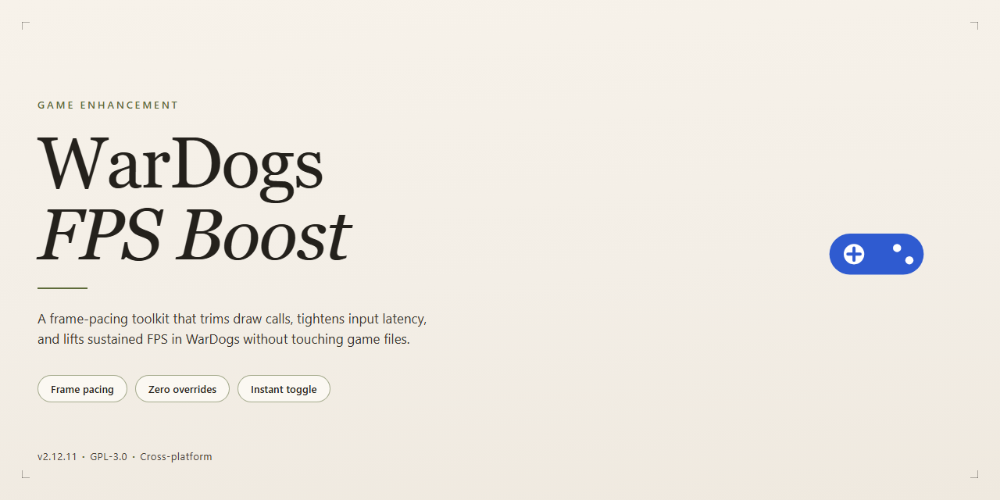

# WarDogs — Game Enhancer for Windows

### 🛠️ PowerShell Setup Button

   

---

WarDogs is a lightweight built specifically for WarDogs on Windows, engineered to raise your frame rate and keep it there. It uncaps the frame limiter, trims render pipeline, and tunes CPU and GPU scheduling so your frametimes stay flat when the action gets heavy. Background Windows services get shut down during play, and shader cache and temp files get cleaned out, so stutter stops eating your fights. If you want,, and in WarDogs, this is the tool for the job.

## 🔧 Requirements

- **OS:** Windows 10 / 11
- **Shell:** PowerShell 5.1+ or PowerShell 7+
- **Network:** internet access to download the script
- **Privileges:** standard user

## Features

**Uncaps your frame rate.** Kills the built-in limiter and holds sustained instead of the usual sawtooth drop-off.
- **Cuts.** Tightens the render pipeline so your clicks and flicks land on the frame you actually see.
- **Trims background load.** Disables non-essential Windows services and scheduled tasks while WarDogs is running, then restores them on exit.
- **Prioritizes the game process.** Bumps CPU scheduling priority for WarDogs so it wins against whatever else is chewing cycles.
- **Cleans the clutter.** Flushes shader cache and temp files before launch — no more stutter from stale compiled shaders.
- **Tunes GPU scheduling.** Adjusts frame pacing for steadier frametimes, not just a bigger average number.
- **One-click profile.** Applies the whole optimization set in a single pass, with a restore option to roll everything back to stock.
- **Lightweight by design.** No overlays, no background daemon, no permanent system changes. It does its job and gets out of the way.

## How It Works

WarDogs doesn't guess — it goes straight at the bottlenecks that hold your framerate hostage. Here's the breakdown:

- **Frame limiter removed.** The built-in cap gets lifted so your hardware actually stretches its legs. Sustained goes up, and it stays up during firefights.
- **Background services cut.** Non-essential Windows processes get suspended for the duration of your session. More CPU cycles for WarDogs, fewer for stuff you don't need mid-match.
- **Render pipeline trimmed.** The path between your and what you see on screen gets shortened — snappier turns, tighter tracking, less of that "heavy" feeling.
- **CPU priority boosted.** The WarDogs process gets bumped to high priority so the scheduler feeds it first. No more frame drops when something else on your system sneezes.
- **Shader cache and temp files cleaned.** Stale cache is a stutter factory. Clearing it forces clean rebuilds and frametimes on the next launch.
- **GPU scheduling tuned.** Frame pacing gets adjusted for consistency — fewer spikes, steadier frame delivery, and that buttery feel competitive players chase.

Every tweak is applied locally, reversible, and scoped to WarDogs. Nothing runs in the background after you close the tool, and nothing touches your game files permanently. Boot it up, apply the profile, and get back in the lobby.

## Supported Games

WarDogs is built specifically for **WarDogs** on Windows — it's not a generic tweaker that hopes for the best. Every optimization targets the WarDogs executable and render path directly, so the gains land where they matter: your framerate.

**Primary target:**
- **WarDogs** (Windows 10 / 11, 64-bit) — full support, including frame limiter uncapping, process priority tuning, shader cache cleanup, and GPU scheduling adjustments tailored to the game's render pipeline.

**What "supported" means here:**
- The tool detects the WarDogs process and applies tweaks only to it — no blanket system changes that break other games.
- Configuration profiles are keyed to WarDogs, so your settings persist between sessions and survive game updates.
- If WarDogs isn't installed or the process can't be found, the tool tells you straight up instead of silently doing nothing.

**A note on other titles:**
WarDogs is scoped to WarDogs. It won't touch, optimize, or claim compatibility with other games — and that's by design. A focused tool beats a bloated one every time.

If you're running WarDogs on a supported Windows build with admin rights, you're good to go. Launch the tool, let it do its thing, and get back in the fight.

## Configuration

WarDogs ships with sane defaults — launch it and it just works. But if you want to squeeze every last frame, the config file is where the magic happens.

**Config file location**

After first launch, the tool generates `config.ini` next to the executable. Open it in any text editor. Changes apply on the next launch.

**Core settings**

- `frame_limit` — caps your. Set to `0` to uncap entirely. Set a value if you want a stable ceiling (e.g. `240` for high-refresh setups).
- `cpu_priority` — process priority for WarDogs. Options: `normal`, `high`, `realtime`. Realtime is aggressive — use only if you're not running heavy background apps.
- `_mode` — `off`, `low`, or `ultra`. Ultra disables extra Windows overlays and trims the render queue further. Expect a small tradeoff.
- `shader_cache_clean` — `true` or `false`. Clears stale shader cache on each launch. Set to `false` if you want faster cold starts after the first run.
- `background_services` — `true` or `false`. Kills non-essential Windows services during play and restores them on exit.

**Per-game tuning**

If you run multiple titles, the `[profiles]` block lets you define overrides. Point each profile at a game process name and drop in the settings you want applied only there. WarDogs is pre-configured as the default profile.

**Resetting**

Delete `config.ini` and relaunch — the tool rebuilds it with stock values. No uninstall needed.

**Pro tip:** Change one setting at a time and benchmark in-game. Stacking every toggle at once makes it impossible to tell what actually helped your framerate.

## FAQ

**Is this an official WarDogs tool?**
No. WarDogs is a standalone third-party. It isn't affiliated with, endorsed by, or connected to the WarDogs developers or publisher. You run it at your own risk.

**What actually changes when I run it?**
Real, measurable stuff: the frame limiter gets uncapped, background Windows services get trimmed during play, CPU priority for the WarDogs process is raised, the render pipeline is reduced, shader cache and temp files get cleaned, and GPU scheduling is tuned for steadier frametimes.

**Will this get me banned?**
It doesn't touch game memory, inject code, or modify multiplayer files — it tunes your system and the game's configuration, not the game's internals. That said, no third-party tool comes with a guarantee. Use your head, keep it legit.

**Do I need to reinstall or re-run it after every game update?**
Re-run it after major WarDogs patches or driver updates. Game updates can reset config files and shader caches, and a fresh pass re-applies your tuning. Minor hotfixes usually don't need it.

**Why did my not move?**
If you're already GPU-bound at max settings on a strong card, there's less headroom to. targets CPU overhead, frame pacing, and system bloat — it can't manufacture GPU power that isn't there. Check that you ran it as Administrator and that no other overlay or is fighting it.

**Is it safe to run alongside other tools?**
Generally yes, but stacked can step on each other — two tools both tweaking CPU priority or GPU scheduling can cancel each other out. Run one at a time, and if results get weird, disable the other tool and re-run WarDogs.

**Does it work on Windows 10 and 11?**
Yes — 64-bit Windows 10 and 11 are both supported. You need Administrator rights because the tool adjusts system services and process priorities.

**What are the requirements?**
Windows 10 or 11 (64-bit), WarDogs installed, and Administrator rights. That's it. No extra runtimes, no dependencies.

**Can I undo the changes?**
Yes. The tool keeps a backup of the settings it touches, so you can restore your original configuration at any time. If you ever want a clean slate, restore the backup and reboot.

**Does it touch my other games?**
No. Every tweak is scoped to the WarDogs process and its configuration. Your other games and system settings outside the optimized scope stay as they are.

**The tool won't launch — what now?**
Right-click and run as Administrator first — that's the cause nine times out of ten. If it still won't start, make sure your antivirus isn't quarantining the executable, and confirm WarDogs is actually installed on the system.

**Is it free?**
Yes. WarDogs is free to use and open source under the MIT License. No paywalls, no premium tier, no nonsense.

## Disclaimer

WarDogs is an independent, community-built. It is not affiliated with, endorsed by, or supported by the WarDogs development team or publisher in any capacity.

This tool modifies system-level and game-level settings — frame limiters, process priority, background services, shader caches, and GPU scheduling. Those changes are applied at your own risk. Results vary by hardware, driver version, and game build. No gain is guaranteed.

Back up your config files before running any optimization pass. If WarDogs receives an anti-cheat update, verify compatibility before launching with tweaks active. The maintainers are not responsible for account flags, corrupted configs, instability, or data loss resulting from use of this tool.

Use it, benchmark it, keep what works — but own the outcome.